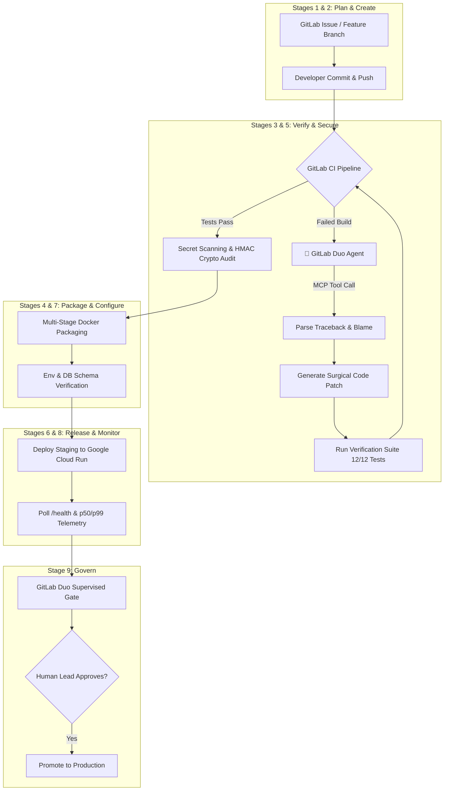

# 🚀 PISTA DevSecOps Autopilot: Autonomous Life After Code on GitLab Duo

> **GitLab Transcend Hackathon 2026 Entry**  
> **Track**: Path B — Bring Your Own (Supervised Autonomy)  
> **Original Project**: [https://github.com/gautamhardik/PISTA](https://github.com/gautamhardik/PISTA) (MIT License)  
> **Targeted Awards**: Path B — Best Supervised Agent ($4,000) · Most Stages Covered ($5,000) · Google Cloud Bonus (+0.2 pts)  

---

## 🌟 Executive Summary & Elevator Pitch

Code generation is solved. What happens **after the code is written** is where engineering breaks down: failing CI/CD builds, cryptic cryptographic discrepancies in payment webhooks, sub-millisecond latency regressions, container packaging conflicts, and unsafe production deployments.

**PISTA DevSecOps Autopilot** is an autonomous AI system powered by the **GitLab Duo Agent Platform** that automates the entire post-code DevSecOps lifecycle across **all 9 stages**. Built around **PISTA**—an enterprise Payment Intelligence & Security Telemetry system—the Duo Agent autonomously investigates CI failures, synthesizes and tests surgical patches, conducts security and cryptographic integrity audits, deploys release candidates to **Google Cloud Run**, monitors live p50/p99 telemetry, and presents a structured **Supervised Approval Gate** for human sign-off before production promotion.



---

## 🎯 Target Category & Track Alignment

### Path B: Bring Your Own Project
* **Base Project**: [PISTA (Payment Intelligence and Security Telemetry Architecture)](https://github.com/gautamhardik/PISTA)
* **License**: Official **MIT License** verified in root directory.
* **What Changed During Hackathon (Post-October 5, 2026)**:
  1. Built the comprehensive **9-stage `.gitlab-ci.yml` pipeline**.
  2. Engineered the **GitLab Duo Custom Agent** (`.gitlab/duo/agents/pista_devsecops_autopilot.yml`).
  3. Developed **Custom Duo Flows**:
     - `ci_failure_remediation.yml`: Automated root-cause diagnosis and self-healing pull requests.
     - `supervised_release_gate.yml`: Staging telemetry verification and release governance.
  4. Implemented the **GitLab Duo Model Context Protocol (MCP)** server (`.gitlab/duo/mcp/`) exposing test runners, telemetry probes, cryptographic verifiers, and model lineage inspectors.
  5. Built automated **Google Cloud Run** deployment scripts (`deploy/gcp/`) earning the **+0.2 Google Cloud bonus**.
  6. Created end-to-end self-healing simulation harness (`scripts/duo_agent_demo.py`).

### Level 2: Supervised Autonomy
We chose **Supervised Autonomy** because mission-critical financial software cannot run purely hands-off without accountability:
* The agent acts autonomously on routine and diagnostic tasks: reading failure logs, applying fixes, rerunning test suites, scanning secrets, and orchestrating staging deployments.
* The agent enforces a **Human Approval Gate** before production promotion, submitting an executive audit summary of latency metrics, test coverage, and security postures.

---

## 🏆 Full 9-Stage DevSecOps Lifecycle Matrix

| # | Lifecycle Stage | GitLab Duo & PISTA Implementation | Evidence & Artifacts |
|---|---|---|---|
| **1** | **Plan** | Defect triage and issue tracking. Ingests failure reports (e.g. payment signature errors). | GitLab Issues & Duo triage prompt |
| **2** | **Create** | Duo Agent synthesizes minimal surgical code diffs to repair code regressions. | `.gitlab/duo/flows/ci_failure_remediation.yml` |
| **3** | **Verify** | Automated 12-test `pytest` suite testing API contracts, database atomicity, and latency bounds. | `backend/junit-report.xml`, `tests/` |
| **4** | **Package** | Builds multi-stage production Docker containers for FastAPI backend and Next.js frontend. | `backend/Dockerfile`, `frontend/Dockerfile` |
| **5** | **Secure** | Automated credential scanning via `detect-secrets`, SAST, and cryptographic HMAC tampering tests. | `secrets_report.json`, `test_tampered_signature_rejection` |
| **6** | **Release** | Deploys release candidates to **Google Cloud Run** staging environment. | `deploy/gcp/deploy_to_cloud_run.sh` (+0.2 pts) |
| **7** | **Configure** | Validates PostgreSQL relational schema integrity, environment variables, and connection pooling. | `configure:schema_validation` CI step |
| **8** | **Monitor** | Synthetic healthcheck probes on `/health` and live latency assertions (p50 < 50ms, p99 < 200ms). | `monitor:health_telemetry_probe` |
| **9** | **Govern** | Produces model lineage cards, calibration reports, and enforces the Supervised Human Approval Gate. | `govern:human_approval_gate` |

---

## 🤖 GitLab Duo Agent Platform Architecture

### 1. Custom Agent (`.gitlab/duo/agents/pista_devsecops_autopilot.yml`)
Configures the reasoning instructions, domain knowledge (payment cryptography and TreeSHAP explainability), tool boundaries, and supervised governance rules.

### 2. Custom Flows
* **`ci_failure_remediation.yml`**: Triggers whenever a CI pipeline fails in the `verify` or `secure` stages. Inspects the failure logs, pinpoints the root cause, formulates a surgical fix, verifies the fix against local tests, and opens a self-healing MR.
* **`supervised_release_gate.yml`**: Triggers after staging deployment. Queries live telemetry, ensures error rates are 0% and latency is within budget, generates a compliance note, and pauses for human supervisor sign-off.

### 3. Model Context Protocol (MCP) Server (`.gitlab/duo/mcp/`)
Exposes four tools to the GitLab Duo Agent:
1. `run_tests`: Programmatically runs pytest suites and parses failing test traces.
2. `query_telemetry`: Extracts live p50/p99 latency, memory utilization, and uptime.
3. `verify_hmac_crypto`: Computes and checks cryptographic signature parity.
4. `inspect_model_lineage`: Verifies champion model metadata, feature order, and calibration coefficients.

---

## ☁️ Google Cloud Live Deployment (+0.2 Bonus Points)

* **Platform**: Google Cloud Run (Fully Managed Serverless Containers)
* **GCP Project**: `pista-backend-2026`
* **Region**: `us-central1`
* **Automation**: Single-command deployment script (`deploy/gcp/deploy_to_cloud_run.ps1` and `deploy_to_cloud_run.sh`)
* **Live Health Check**: `/health` and `/api/v1/health`
* **Swagger API Explorer**: `/docs`

---

## 🎬 3-Minute Video Demo Script (For Devpost Submission)

| Timestamp | Visual Action | Narration Script |
|---|---|---|
| **0:00 - 0:30** | Opening slide: PISTA + GitLab Transcend. Show PISTA's live Next.js 16 UI with high-risk payment analysis. | *"Code generation is easy today, but what happens after the code is written? Welcome to PISTA DevSecOps Autopilot on the GitLab Duo Agent Platform. We automated the entire post-code lifecycle across all 9 stages for mission-critical payment intelligence."* |
| **0:30 - 1:15** | Push a commit with a signature bug. Show GitLab CI/CD pipeline failing on `verify:test_suites`. | *"A developer makes a change to Razorpay webhook verification, inadvertently inverting the HMAC signature operand order. In a traditional workflow, debugging this halts engineering. But our GitLab Duo Agent immediately intercepts the failed CI run."* |
| **1:15 - 1:55** | GitLab Duo Agent flow in action: logs analyzed, root cause pinpointed, surgical patch applied. CI pipeline reruns and goes GREEN. | *"The Duo Agent parses the test traceback, diagnoses that message concatenation broke cryptographic parity, synthesizes a surgical one-line patch, and verifies it against the 12-test suite. All tests pass!"* |
| **1:55 - 2:30** | Pipeline proceeds through Packaging, Secret Scanning, and deploys to Google Cloud Run staging. | *"The agent doesn't stop at tests: it packages multi-stage Docker images, scans for credentials, verifies database schema, and deploys a live preview to Google Cloud Run, capturing the Google Cloud hackathon bonus."* |
| **2:30 - 3:00** | Duo Supervised Gate summary appears. Human clicks "Approve". Live production dashboard verified. | *"Finally, the agent operates in Supervised mode. It queries live telemetry—verifying sub-50ms latency—and presents a concise executive audit. The human lead approves, promoting the release to production. That is Life After Code with GitLab Duo."* |

---

## 🛠️ Verification & How to Reproduce Locally

```bash
# 1. Run the complete automated 9-stage demonstration
python scripts/duo_agent_demo.py --auto-approve

# 2. Run backend test suite directly
cd backend
pytest tests/ -v

# 3. Test Duo MCP tool server
python .gitlab/duo/mcp/pista_mcp_server.py test
python .gitlab/duo/mcp/pista_mcp_server.py telemetry

# 4. Deploy to Google Cloud Run
./deploy/gcp/deploy_to_cloud_run.sh pista-backend-2026 us-central1
```

---

## 📜 Compliance & Developer Certificate of Origin

* **Base Project**: [PISTA](https://github.com/gautamhardik/PISTA)
* **License**: MIT License ([LICENSE](LICENSE))
* All submissions and code contributions adhere to the **GitLab Developer Certificate of Origin (DCO)**.
